# Koreader_patches

User patches for [KOReader](https://github.com/koreader/koreader), built for e-ink reading
with the [Project: Title](https://github.com/joshuacant/ProjectTitle) plugin.

> Tested with **KOReader v2026.07** and **Project: Title v3.8.3** on a Kindle Paperwhite (11th gen).

## Installation

1. Connect your e-reader to a computer and open the `koreader/` folder.
2. Create a `patches/` folder if it doesn't exist.
3. Copy the `.lua` files you want from this repository's [`patches/`](patches) folder.
4. Restart KOReader. Patches are listed under *Settings → Patch management*, where they can
   also be turned off.

Every file starts with a comment block explaining its goal, what it does and how to use it.
Patches with options have a configuration table right below that block.

## Patches

| Patch | Summary |
|---|---|
| [`2-cover-grid.lua`](#2-cover-gridlua) | Uniform covers and reading badges in the Project: Title grid |
| [`2-physical-pages.lua`](#2-physical-pageslua) | Page numbers that match the printed edition |
| [`2-highlights.lua`](#2-highlightslua) | Every style carries a meaning, colors on distinct grays, grid pickers, a marker guide and filter shortcuts |
| [`2-highlight-styles.lua`](#2-highlight-styleslua) | Extra highlight styles: wavy, box, brackets, big colored quotes, faux bold and italic and more |
| [`2-reading-dates.lua`](#2-reading-dateslua) | Start and finish date of every book |
| [`2-progress-bar.lua`](#2-progress-barlua) | Progress bar styles for the status bar while reading |
| [`2-reading-session.lua`](#2-reading-sessionlua) | Session summary, daily goal with streak, and a recap when coming back to a book |
| [`2-vocabulary-highlights.lua`](#2-vocabulary-highlightslua) | Highlights of the vocabulary color go to the Vocabulary builder |
| [`2-sleep-screen.lua`](#2-sleep-screenlua) | Book cover and progress on the sleep screen while reading |
| [`2-reading-stats.lua`](#2-reading-statslua) | One screen with book, week and year statistics |
| [`2-light-control.lua`](#2-light-controllua) | Brightness and warmth with a visible slider, absolute edge swipes and presets |
| [`2-status-bar.lua`](#2-status-barlua) | Time left in words and tidier compact items in the status bar |
| [`2--fonts.lua`](#2--fontslua) | Interface font picker and steady Project: Title font sizes |

---

### `2-cover-grid.lua`

Makes the bookshelf uniform: every cover has the same aspect ratio, including the thumbnails
that represent folders, and reading information shows up as small badges.

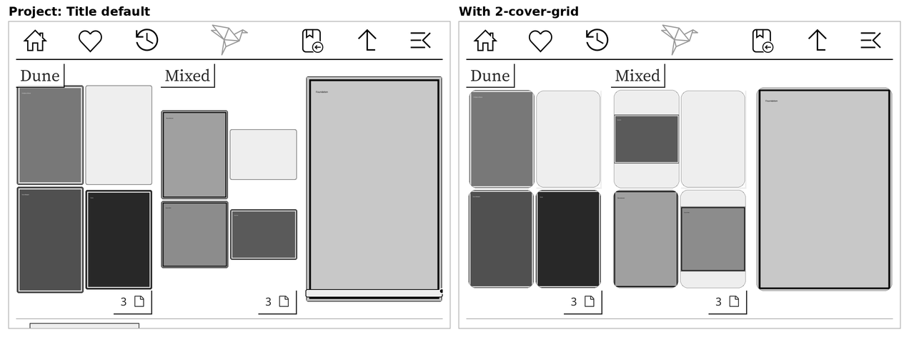

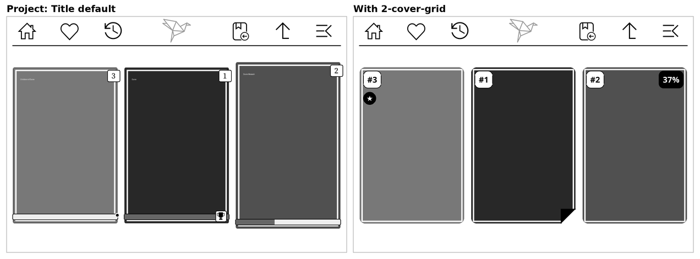

- **One aspect ratio (2:3)** for books, folder thumbnails and the generated covers of books
  without an image. Very wide covers are centered on a gray background instead of distorted.
- **Rounded corners** drawn by the patch itself, no extra icon files needed.
- **Reading badges** you can mix and match, with four presets to start from.

Everything is set in *Project: Title settings → Cover badges*:

| Option | Choices |
|---|---|
| Apply a preset | Classic, Medals, Quest, Rings |
| Progress | badge (with a flame), XP bar, XP bar and badge, ring, hidden — see below |
| Finished / on hold | medal (trophy), award, stamp, ribbon, banner, check, dog-ear, hidden — see below |
| Badge size | small, medium, large |
| Icons inside badges | flame, hourglass and book icons on or off |
| Series number | `#2` on the top left |
| Page count on new books | page count on books not opened yet |
| Collection star | star on books that are in a collection |
| Fade finished covers | lightens the covers of finished books |
| Idle after | days without opening a book in progress before its progress turns into an hourglass (gray bar or ring); 0 turns it off |

**Progress** on books you are reading. Every option also shows when a book was not opened
for longer than *Idle after*:

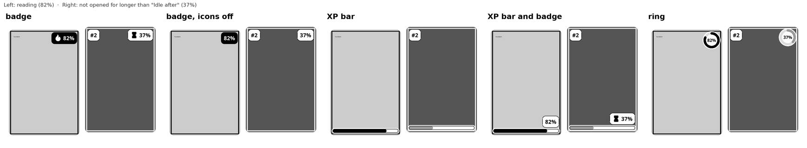

**Finished / on hold** marks:

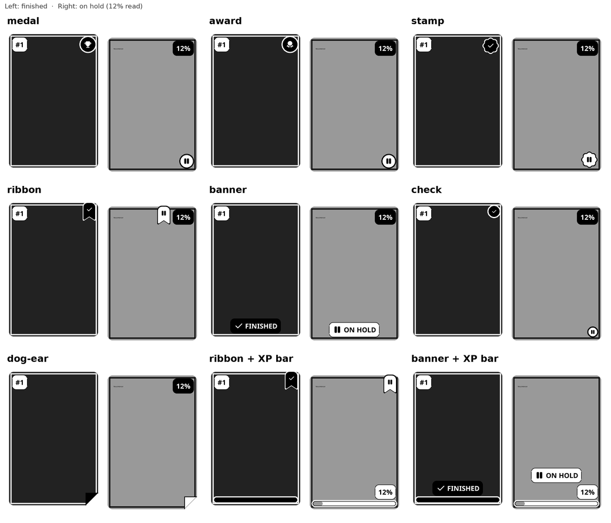

The idle mark is only visual: the book status stays *Reading*. Defaults for every option, plus
aspect ratio and corner radius, live in the `CONFIG` table at the top of the file.

Requires Project: Title in *Cover Grid* mode. Icons from [Tabler Icons](https://tabler.io/icons) (MIT).

---

### `2-physical-pages.lua`

Makes page 120 on the reader be page 120 of the physical book. The patch tunes KOReader's
*stable page numbers*, working out how many characters fit on each page so that the total
matches the printed edition.

The page count comes from one of two sources, per book:

- **Automatic:** [Open Library](https://openlibrary.org) lookup by the EPUB's ISBN or, without
  an ISBN, by title and author (needs Wi-Fi).
- **Manual:** you type the page count of your edition.

Found under *Menu → navigation tab → Settings → Stable page numbers → Printed edition pages*,
with an EPUB open. The value is saved and applied again every time the book is opened. Books
that already ship the publisher's page numbers are left untouched unless you set a value
manually.

---

### `2-highlights.lua`

Gives each highlight a meaning through its **style** and keeps the **colors** as plain colors
that stay distinguishable on a grayscale e-ink screen.

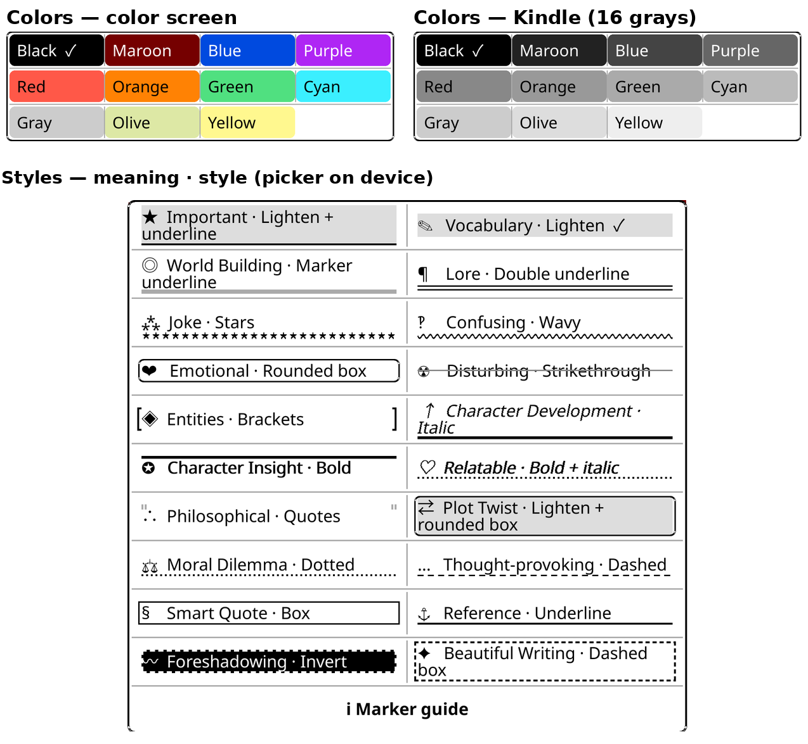

- **A meaning for every style:** all 20 styles carry a meaning, from ★ *Important* and
  ◎ *World Building* to ✦ *Beautiful Writing* and ⚖ *Moral Dilemma*. Style buttons read
  “★ Important · Lighten + underline”, icon and word each lined up in their own column across
  the whole grid, and the styles with a meaning come first. Each name also shows a small preview
  of the style itself (its underline, border, stars, brackets, and so on) next to the text.
- **Marker guide:** the ℹ button at the bottom of the style picker opens a full-screen guide
  listing every style with its icon, meaning, style name and a short explanation of what it's
  for — a reminder of the whole system without leaving the book.
- **Preview style on names:** a toggle in *Menu → tools tab → More tools → Highlight labels*
  turns the preview decoration next to each style name on or off.
- **Colors on distinct grays:** eleven colors, each tuned to land on its own gray level of a
  16-level e-ink screen, from Black (level 0) to Yellow (level 14). The hue is kept, so they
  stay recognizable on color screens and in exports. Gray is the vocabulary color of
  [`2-vocabulary-highlights.lua`](#2-vocabulary-highlightslua).
- **White text on the dark colors** (Black, Maroon, Blue, Purple), on the picker buttons and,
  with [`2-highlight-styles.lua`](#2-highlight-styleslua), on the page.
- **Grid pickers:** colors 4 per row and styles 2 per row, so the whole list fits on the screen.
- **Renamable on the device:** *Menu → tools tab → More tools → Highlight labels* renames any
  color or style meaning, applied right away. An empty name goes back to the default.
- **Filter shortcuts:** three gesture actions (*Settings → Taps and gestures → Gesture
  manager*) filter the highlight list by style, by color, or by both.

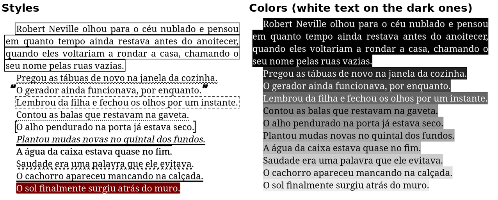

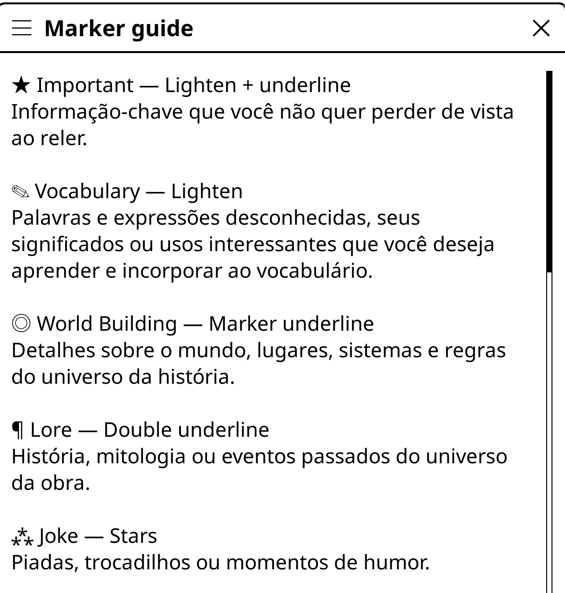

Colors, tones, default meanings, guide text and grid columns are in the `CONFIG` table. A
default color for new highlights is set natively in *Menu → typeset tab → Highlights →
Highlight color* (long-press to make it the default for every book).

---

### `2-highlight-styles.lua`

Adds highlight styles next to KOReader's four (lighten, underline, strikethrough, invert):
wavy, double, dashed and dotted underlines, a row of stars, a thick marker line, box, dashed
box and rounded box, brackets around the passage, large quotes around it, faux bold, faux
italic and bold italic, and lighten combined with an underline or a rounded box.

- The styles show up in every style picker, as if they were native.
- *Quotes* draws bold “ ” marks well clear of the text, in the highlight's own color, so they
  stand out on the page instead of blending into small gray marks.
- *Invert* keeps a strip of the highlight color under the text, so the color isn't lost.
- With a dark color, *Lighten* (and its combinations) draws white text on the color instead
  of black text on a dark background.

---

### `2-reading-dates.lua`

Records when each book was started and finished, automatically:

- **Started:** the date the book was first opened.
- **Finished:** the date the book was marked as finished, no matter how.

The dates show up in *Book information* and are saved in the book metadata
(`started_on` and `finished_on`). To undo an accidental opening, use *Reset* in the file
manager.

---

### `2-progress-bar.lua`

New looks for the status bar progress bar while reading, chosen in
*Status bar → Progress bar → Style*:

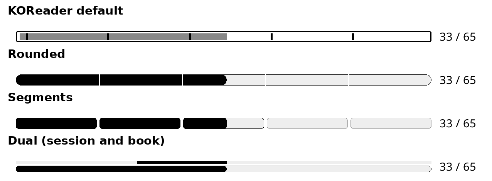

- **Rounded:** one rounded bar with a small gap where each chapter starts.
- **Segments:** one block per chapter, like quest stages — chapters already read are filled
  and the current one fills up as you read.
- **Thin with chapter ticks:** a thin line with a mark at every chapter — notches in the part
  already read, gray ticks ahead, and a bold tick where the current chapter ends.
- **Dual (session and book):** the thin line marks the stretch read in this session, from the
  page where you opened the book to the current one; the bar below shows the whole book.
- **KOReader default** keeps the original bar.

Chapters come from the first level of the table of contents. Books with many chapters get a
simpler look so the bar stays readable: *Segments* is drawn as *Rounded* above 25 chapters, and
above 60 chapters the chapter gaps and ticks are left out (both limits are in the `CONFIG` table). A taller
bar (*Thickness, height & colors*) suits the dual style.

KOReader's *Show initial position marker* option becomes a small triangle just above the bar,
pointing at the page where the session started, so it stays visible over the filled part. *Dual*
leaves it out, since its top line already shows the session.

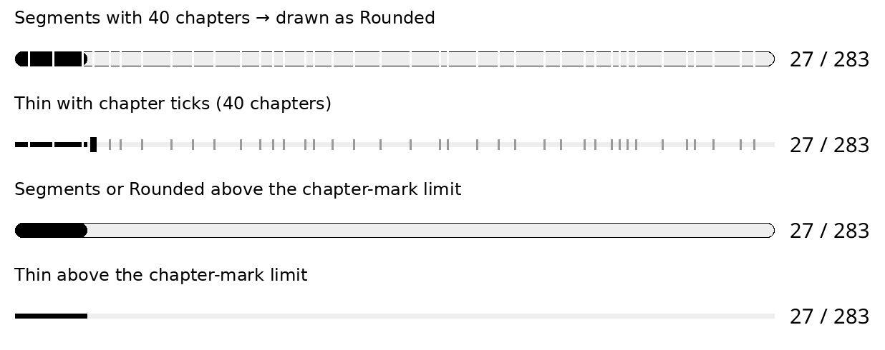

---

### `2-reading-session.lua`

Makes each reading session count, in three parts that can be turned on or off:

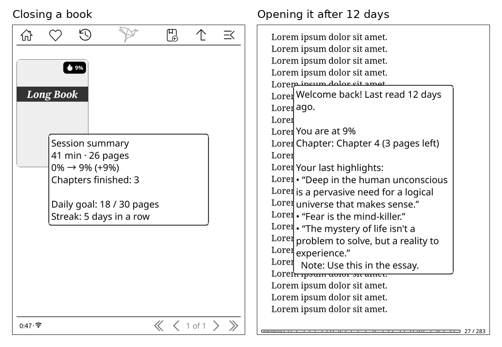

- **Session summary:** when you close a book, a message shows the time read, the pages read,
  how the percentage moved and how many chapters you finished. Pages count from where you opened
  the book: that page is zero, so going forward two pages and back two to check something counts
  as nothing, and going back before it shows zero. A jump (table of contents, link, go to page)
  moves the starting point along with you, so only page turns count (taps, swipes, keys or
  scrolling); changing the font or the layout doesn't count either. Scroll mode and the
  two-page mode work too. It only shows after a minimum of pages
  and/or minutes, picked from presets (1, 5 or 10 pages, 5 pages and 5 min, 10 pages and
  10 min, 15 min) or set by hand. The default is 5 pages.
- **Daily goal and streak:** a goal in pages or minutes per day. The summary shows today's
  total against the goal and how many days in a row you reached it. Totals come from the
  *Reading statistics* plugin, so they add up every book read that day.
- **Where was I?:** when you open a book you haven't opened for a number of days (7 by
  default), a recap shows how long it has been, the current chapter with the pages left in it,
  and your last highlights and notes in that book.

Settings are in *Menu → Tools → Reading session*, while reading. The goal and the streak need
the *Reading statistics* plugin enabled; the summary and the recap work without it.

---

### `2-vocabulary-highlights.lua`

Collects new words with a single highlight: give a highlight the gray color (reserved for
vocabulary by `2-highlights.lua`) and the word goes to KOReader's
*Vocabulary builder*, ready for flashcard review with spaced repetition.

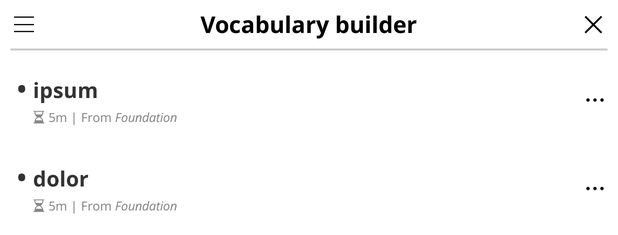

- Works when the highlight is created gray and when an existing highlight is changed to gray.
- The book title and the sentence around the word are saved as context, the same way a
  dictionary lookup does it.
- Highlights longer than four words are left out, and words already in the Vocabulary builder
  are not reset.
- *Menu → search tab → Vocabulary from highlights* turns the automatic adding on or off and
  adds every gray highlight of the open book at once, for books highlighted earlier.

The color and the word limit are in the `CONFIG` table. Needs the Vocabulary builder plugin,
which is enabled by default.

---

### `2-sleep-screen.lua`

When the device sleeps in the middle of a book, the sleep screen shows that book: a large cover
and where you are in the chapter and in the book. In the file manager nothing changes — the
wallpaper set in the sleep screen settings is used, for example a random image from a folder.

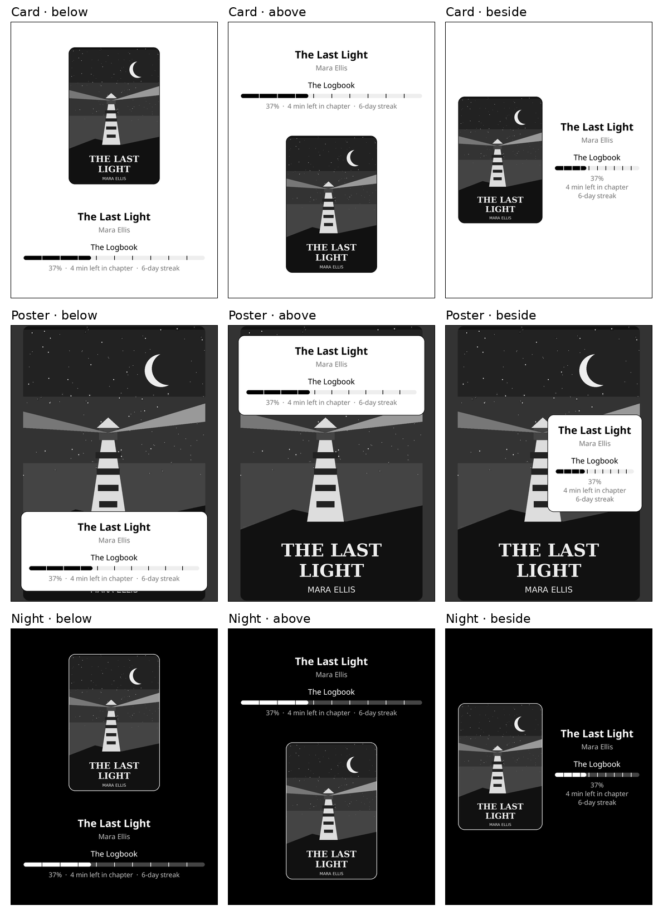

- **Chapter:** name, progress bar, page in the chapter, percentage and time left.
- **Book:** title, progress bar with chapter marks, page, percentage and time left. Page numbers
  follow *stable page numbers* when they are on, so they match `2-physical-pages.lua`.
- **Last line:** reading streak, today's goal and the time the device went to sleep.

Options in *Settings → Screen → Sleep screen → Book on sleep screen* — three choices with two
options each, plus the last line on or off:

| Choice | Options |
|---|---|
| Details | *Columns* (chapter and book side by side, largest cover) or *Rows* |
| Theme | *Light* or *Dark* |
| Position | details *below* or *above* the cover |

- It replaces the *random image* and *book cover* wallpapers only while reading; the other
  wallpaper types are left alone.
- Books marked *Do not show this book cover on sleep screen* and books without a cover keep the
  regular wallpaper.
- Time left comes from *Reading statistics*. The streak uses the daily goal of
  `2-reading-session.lua` when it is set, and any day with reading otherwise.

---

### `2-reading-stats.lua`

One full-screen page for the numbers of *Reading statistics*, every value labelled in words.
Swipe left or right, or tap a tab, to move between:

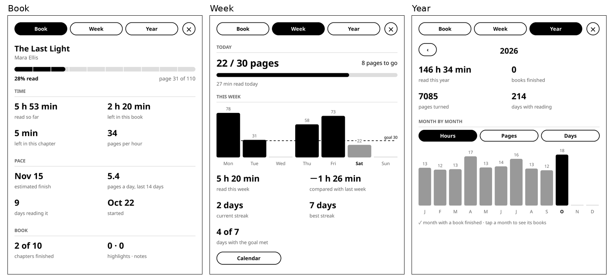

- **Book:** progress with chapter marks, time read, time left in the chapter and in the book,
  pages per hour, an estimated finish date at your pace of the last 14 days, days spent on the
  book, start date, chapters finished, highlights and notes.
- **Week:** today against the daily goal, the week day by day with the goal line, this week
  against last week, current and best streak, and a button to KOReader's calendar.
- **Year:** totals for the year, books finished, and month by month in hours, pages or days.
  Tap a month to see the books read in it.

The goal and the streak are the ones of `2-reading-session.lua`, so every patch shows the same
streak. Open it from *Tools → Reading stats* or give the *Reading stats* action to a gesture;
it works in the reader and in the file manager (without the Book tab). Needs the Reading
statistics plugin.

---

### `2-light-control.lua`

Makes the frontlight easier to adjust while reading:

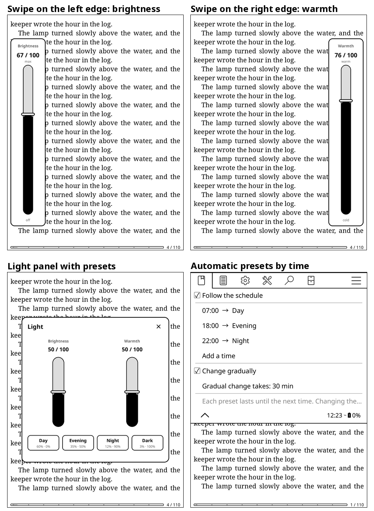

- **Absolute edge swipes:** swiping along the left edge (brightness) or the right edge (warmth),
  KOReader's default light gestures, sets the level to where the finger stops — top of the
  screen is the maximum, bottom the minimum — instead of nudging it a few steps.
- **Visible slider:** a large slider with the current level shows up on that edge. Tap or drag
  on it to fine-tune; it closes after a few seconds without touching, or with a tap elsewhere.
- **Presets:** brightness and warmth together in one tap. *Day*, *Evening*, *Night* and *Dark*
  come ready and the current light can be saved as a new one. Hold a preset to set its values
  (from the current light or typed in), rename it or remove it.
- **Light panel:** both sliders and the presets on one card, from the menu or a gesture
  (*Light panel* action).
- **Automatic presets:** a schedule of times, each starting a preset that lasts until the next
  time — for example *Day* at 07:00, *Evening* at 18:00 and *Night* at 22:00. Each time takes
  only one preset, so they never overlap. The preset is applied when its time arrives or when the
  device wakes up in a new period; changing the light by hand keeps your choice until the next
  time on the schedule. *Change gradually* blends the light into the next preset over the minutes
  before it starts (30 by default), and stops blending if you adjust the light yourself.

Everything is in *Settings → Light presets*, including the schedule (*Automatic presets*, off
until you turn it on), turning the absolute swipes or the slider off and how many seconds the
slider stays open.

---

### `2-status-bar.lua`

Small changes that make the reading status bar easier to read:

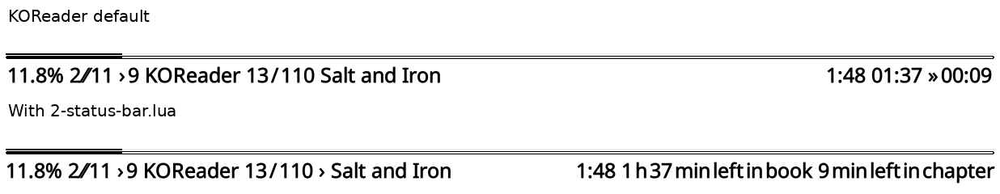

- **Time left in words:** "1 h 37 min left in book" and "9 min left in chapter" instead of
  "01:37" and "00:09" (needs *Reading statistics*).
- **Compact items:** the regular frontlight icons, which are clearer than the compact ones,
  and the battery percentage next to its icon.
- **Compact items with no separator:** a small arrow before the title, chapter and author, so
  they don't run into the numbers around them.

Each part can be turned off in the `CONFIG` table.

---

### `2--fonts.lua`

- **UI font:** *Settings → UI font* lists the fonts installed for books, each shown in its own
  typeface. The choice replaces Noto Sans in menus and dialogs after a restart.
- **Project: Title sizes:** sets the font size limits of the library. By default Project: Title
  uses the largest size that fits each title, so titles end up in different sizes; the values
  in `PT_SIZES` keep one size for all of them.

The name starts with `2--` so it runs before the other patches create any text.

---

## Development

The [`dev/`](dev) folder holds what is used to test the patches in a KOReader emulator
(the Linux build of KOReader running at the Paperwhite 11 resolution):

- `make_books.py` builds test EPUBs with covers of varied aspect ratios and a series.
- `shot.sh` opens the emulator on a folder or book and saves a screenshot.

## Credits

These patches were rewritten from community ideas:

- **SeriousHornet** — [KOReader.patches](https://github.com/SeriousHornet/KOReader.patches):
  rounded and stretched covers, page, percentage, series, collection and status badges.
  Basis for `2-cover-grid.lua`.
- **Paweł Kuna** — [Tabler Icons](https://github.com/tabler/tabler-icons) (MIT): trophy, pause,
  flame, hourglass and book shapes used by `2-cover-grid.lua`.
- **dmalinovsky** — `2-logical-page-count.lua` gist: synthetic pages by character count.
  Starting point for `2-physical-pages.lua`.
- **Kaya** — Statistics plugin fork with `applyPerfectSync`, which matched page numbers to a
  physical page count. `2-physical-pages.lua` reads the values it saved.
- **sebdelsol** — [KOReader.patches](https://github.com/sebdelsol/KOReader.patches): UI font
  menu, better compact status bar items and thin progress bar with chapter marks. Basis for
  `2--fonts.lua`, `2-status-bar.lua` and the *Thin* style of `2-progress-bar.lua`.
- **quanganhdo** — [koreader-user-patches](https://github.com/quanganhdo/koreader-user-patches):
  reading stats and reading insights popups, time left in words. Basis for
  `2-reading-stats.lua` and `2-status-bar.lua`.
- **Andreas Lösel** — Project: Title font size patch. Basis for `2--fonts.lua`.
- **omer-faruq** — dual-state sleep screen patch: a different sleep screen inside a book and in
  the file manager. Idea behind `2-sleep-screen.lua`.
- A highlight color theme shared on Reddit and a highlight filter patch, both by unknown
  authors. Basis for `2-highlights.lua`.

## License

[AGPL-3.0](LICENSE), the same as KOReader.
